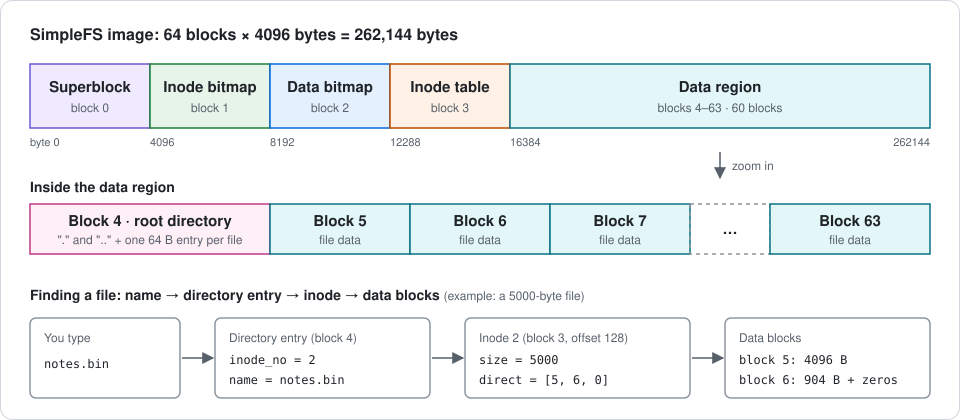

# SimpleFS — A Tiny File System in C

[](https://github.com/tanvirul-islam-rifat/simplefs-file-system/actions/workflows/ci.yml)


Two C programs that create and modify a **binary file-system image**: a 256 KiB "disk" with a superblock, inode and data bitmaps, an inode table, a root directory and first-fit block allocation. `simplefs_builder` formats an empty image; `simplefs_adder` copies a regular file into it. Built for **CSE321 — Operating Systems** (lab term project) at BRAC University, then extended with an independent image checker, a 38-test suite and CI.



## Quick Start

```bash
make                                                          # builds into build/
build/simplefs_builder --image disk.img                       # empty 262,144-byte image
build/simplefs_adder --input disk.img --file samples/test1.txt
python3 tools/simplefs_inspect.py disk.img                    # dump + consistency check
make test                                                     # full test suite
```

Requires a C11 compiler (`gcc` or `clang`), `make` and Python 3 (standard library only). `xxd`/`hexdump` work on the image too, as the original assignment intended.

### Example session

```
$ build/simplefs_builder --image disk.img
SimpleFS image created successfully: disk.img
$ build/simplefs_adder --input disk.img --file samples/test1.txt
samples/test1.txt added successfully to disk.img
$ build/simplefs_adder --input disk.img --file samples/test2.txt
samples/test2.txt added successfully to disk.img
$ build/simplefs_adder --input disk.img --file /tmp/notes.bin        # a 5000-byte file
/tmp/notes.bin added successfully to disk.img

$ python3 tools/simplefs_inspect.py disk.img
SimpleFS image: 262144 bytes
  magic 0x53465331, block size 4096, 64 blocks, 32 inodes
  inode bitmap: block 1, data bitmap: block 2, inode table: block 3, data region: blocks 4-63
Inode bitmap : 0f 00 00 00   inodes in use: 1-4
Data bitmap  : 1f 00 00 00 00 00 00 00   blocks in use: 4-8
Root directory (inode 1, 320 bytes)
  slot  inode  type    size  blocks    name
     0      1  dir      320  4         .
     1      1  dir      320  4         ..
     2      2  file      22  5         test1.txt
     3      3  file      77  6         test2.txt
     4      4  file    5000  7, 8      notes.bin
Consistency check: OK

$ build/simplefs_adder --input disk.img --file samples/test1.txt
Error: file already exists in SimpleFS.
```

Programs print errors to stderr and exit with status 1; they never crash on bad input (missing files, wrong arguments, corrupt or truncated images).

## Fixed Parameters

| Parameter | Value |
|---|---|
| Block size / blocks | 4096 bytes / 64 → 262,144-byte image |
| Inodes | 32 × 128 bytes (exactly one block); inode 1 is the root |
| Direct pointers per inode | 3 → **max file size 12,288 bytes** |
| Directory entry | 64 bytes (`inode_no`, `type`, 59-byte name) → **max name 58 characters** |
| Layout | block 0 superblock · 1 inode bitmap · 2 data bitmap · 3 inode table · 4–63 data (block 4 = root directory) |
| Capacity | 31 user files; 59 free data blocks after formatting |

## How It Works

**Three numbering schemes** are the classic source of bugs in this project, so the code names the conversions once (`INODE_BIT`, `DATA_BIT`, `inode_offset`, `block_offset`):

| Thing | Number | Conversion |
|---|---|---|
| Inode | 1…32 | bitmap bit = inode − 1 · byte offset = 3×4096 + (inode − 1)×128 |
| Data block | absolute 4…63 | bitmap bit = block − 4 · `direct[]` stores the absolute block |
| Directory entry | slot 0…63 | slots 0 and 1 are `.` and `..`; `inode_no == 0` means unused |

**`simplefs_builder`** zero-fills 64 blocks, writes the superblock, sets bit 0 in both bitmaps (root inode, root data block), writes the root inode (directory, 2 links, size 128, `direct[0] = 4`) and the `.` / `..` entries.

**`simplefs_adder`** adds one file as a sequence of steps, in this order:

1. Validate the image (superblock fields and image length) and open the source file.
2. Reject names over 58 characters, files over 12,288 bytes and duplicate names.
3. First-fit search for a free inode and `ceil(size / 4096)` data blocks, **in memory only**.
4. Find a free root-directory slot.
5. Copy the data block by block into zero-filled buffers, so a partial last block is padded with zeros.
6. Write the inode (real byte size, absolute block numbers), then both bitmaps, then the directory entry, then grow the root inode by 64 bytes.

Because every check and every allocation happens before the first write, **a rejected `add` leaves the image byte-for-byte unchanged**, which the tests assert. The directory entry is written late, so an I/O failure part-way leaves the file unreachable by name rather than half-visible. Design notes are in [`docs/design.md`](docs/design.md).

## Testing

```bash
make test                              # builds, then runs 38 tests (~3 s)
make clean && make SANITIZE=1 test    # same, under AddressSanitizer + UBSan
python3 tests/mutation_check.py        # plants 16 bugs, checks the suite catches each
```

- **Independent oracle.** [`tools/simplefs_inspect.py`](tools/simplefs_inspect.py) re-implements the on-disk format in Python from the specification. After every successful `add`, the tests run its consistency check: bitmaps match what inodes and directory entries reference, no block is shared, sizes match block counts, unused slots and free blocks are all zero, the root size equals 64 × entries, and so on. The checker's own tests confirm it flags 14 different kinds of corruption.
- **Spec coverage.** Empty image, superblock, bitmaps, root directory, one/two/three-block files, every size boundary (0, 1, 4095, 4096, 4097, 8191 … 12288), multiple files, duplicates, oversize, missing source, missing image, bad magic, wrong geometry, truncated image, name length 58 vs 59, 31-file inode exhaustion, data-block exhaustion (including that a failed attempt leaks nothing), a full root directory, bad command lines.
- **Golden image.** Building the image from `samples/test1.txt` and `samples/test2.txt` yields the same SHA-256 as the image produced by the original course submission.
- **Mutation check.** `tests/mutation_check.py` plants 16 single-line bugs (off-by-one limits, bitmap index mistakes, missing updates) one at a time and confirms the suite fails for each.

Verified on Linux with GCC 13 (clean under `-Wall -Wextra -Wpedantic`, sanitizers on). CI also builds and tests on macOS.

## What Changed Since the Course Submission

The submitted programs were already correct: for every scenario tried (all size boundaries, resource exhaustion, error cases) the refactored code produces byte-identical images and the same messages. After the course, this repository added:

- A shared module (`src/common.c`) instead of duplicated helpers, plus `_Static_assert`s that pin the struct sizes the format depends on.
- Checked I/O on every read, write, seek and `fclose` (the assignment's "file read/write errors" requirement), with the builder removing a half-written image.
- Stricter image validation: all superblock fields and the image length, not only the magic number, so a truncated image is rejected instead of silently grown.
- The adder stores only the file's base name, so `--file samples/test1.txt` works from any directory.
- Errors go to stderr; message texts are unchanged.
- The inspector/checker, test suite, mutation check, Makefile and CI.

## Limitations & Honest Notes

- Single flat directory; no subdirectories, deletion, renaming, or a read command (`tools/simplefs_inspect.py --cat` exists for verification only).
- Files are capped at 12,288 bytes (no indirect blocks) and 31 files per image.
- No journaling or locking: a crash between the steps of an `add` can leave orphaned data blocks or an unreferenced inode. Write order limits the damage but does not remove it.
- Structures are written in host byte order, so images are portable between little-endian machines only (x86-64 and ARM, in practice).
- Not mountable; this is an educational image format, not a Linux file system.
- Tested on Linux locally; macOS coverage comes from CI.

## Repository Structure

```
├── include/simplefs.h          # constants, on-disk structs, static asserts, helper declarations
├── src/
│   ├── common.c                # bitmaps, offsets, checked I/O, superblock helpers
│   ├── simplefs_builder.c      # formats an empty image
│   └── simplefs_adder.c        # adds a file to an image
├── tools/simplefs_inspect.py   # image dump, consistency checker, --cat
├── tests/
│   ├── test_simplefs.py        # 38 end-to-end tests
│   └── mutation_check.py       # planted-bug check of the test suite
├── samples/                    # test1.txt, test2.txt, test3.txt
├── docs/
│   ├── design.md               # format, algorithms, failure behaviour
│   └── images/disk-layout.svg
├── .github/workflows/ci.yml    # Linux + macOS build/test, sanitizer job
├── Makefile
└── LICENSE
```

## Technical Architecture

- **Language:** C11 (programs), Python 3 standard library (inspector and tests)
- **Paradigm:** Systems programming: fixed-layout binary file-system format, block-level file I/O with `fseek` / `fread` / `fwrite`
- **Build:** Make, `-Wall -Wextra -Wpedantic -std=c11`; optional AddressSanitizer + UBSan
- **Data storage:** A single 262,144-byte binary image file
- **Interface:** Command-line tools
- **CI:** GitHub Actions (Ubuntu, macOS, sanitizer job)

## Core Engineering Practices Demonstrated

- **File-System Internals:** Superblock, inode table, allocation bitmaps, directory entries and direct block pointers, with first-fit allocation over both bitmaps.
- **Binary Format Discipline:** Packed structs verified by static asserts; one place for inode / bitmap-bit / absolute-block conversions; unused regions kept zero.
- **Failure-Safe Design:** Allocate in memory, validate everything, then write; rejected operations leave the image unchanged; every I/O result is checked.
- **Independent Verification:** A second implementation of the format in Python acts as the test oracle, and a golden hash ties the output to the original submission.
- **Test Quality Measurement:** A mutation check shows the suite catches 16 planted defects rather than only passing on correct code.
- **Defensive Input Handling:** Truncated, corrupt, oversized and mis-named inputs produce clear errors, never crashes (sanitizers on in CI).
- **Honest Reporting:** Limitations and the differences from the original submission are documented.

## Authors

**Md. Tanvirul Islam Rifat**: `simplefs_builder.c` (superblock, bitmap formatting, root inode, `.` / `..` entries), the original README, and the post-course tooling, tests and documentation in this repository.
- **GitHub:** [@tanvirul-islam-rifat](https://github.com/tanvirul-islam-rifat)
- **LinkedIn:** [Tanvirul Islam Rifat](https://www.linkedin.com/in/tanvirul-islam-rifat)

**Mourika Nigar Mouny**: original `simplefs_adder.c` (first-fit inode and block search, data copy loop, directory-entry and root-size updates) and hex-dump testing in the course submission.
